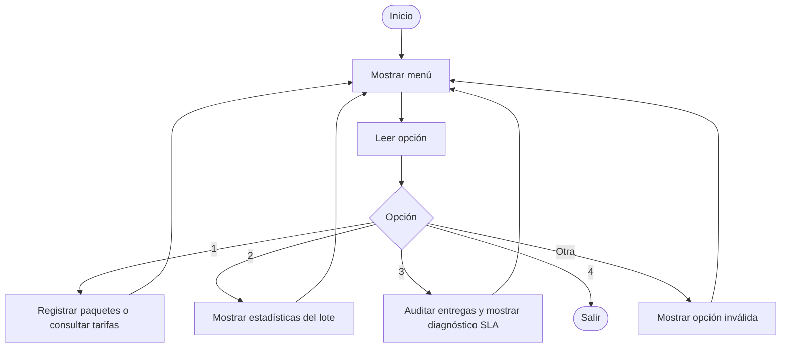
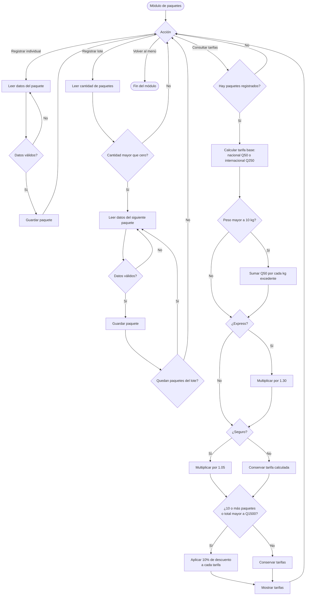
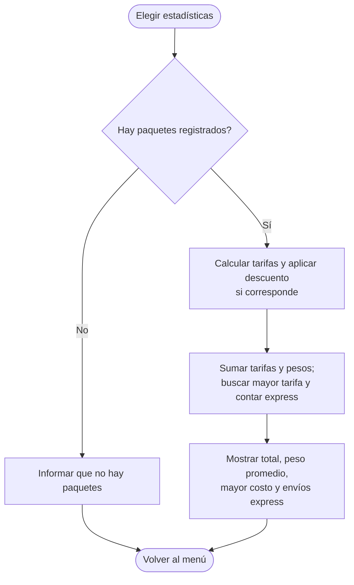
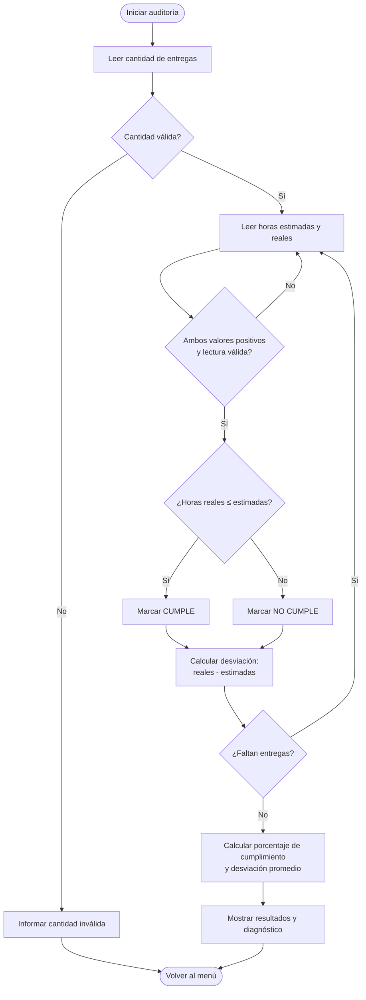

# LogiTech Express

Programa de consola en C++ para registrar paquetes, calcular tarifas y auditar entregas según su SLA.

## Compilar y ejecutar

Desde esta carpeta, compila con un compilador compatible con C++11:

```bash
g++ -std=c++11 logitech-v1.cpp -o logitech-express
```

En Windows, ejecuta:

```powershell
.\logitech-express.exe
```

## Funciones

- Registrar paquetes individualmente o en lote, consultar tarifas y ver estadísticas.
- Auditar entregas comparando las horas estimadas con las reales.

## Reglas principales

- Tarifa base: Q50 para destino nacional y Q250 para internacional.
- Por cada kilogramo por encima de 10 kg se agregan Q50.
- Express multiplica la tarifa por 1.30; el seguro la multiplica por 1.05.
- Se aplica un descuento de 10% a cada tarifa si hay 10 o más paquetes o si el total antes del descuento supera Q1500.
- Una entrega cumple el SLA si las horas reales son menores o iguales a las estimadas.

## Diagramas de flujo

Los diagramas están escritos en Mermaid, formato que draw.io puede importar como diagramas editables. Reflejan la lógica actual del programa; los diagramas anteriores en `../doc/diagrama` contienen reglas distintas.

### Menú principal



### Registro y cálculo de tarifas



### Estadísticas del lote



### Auditoría SLA


